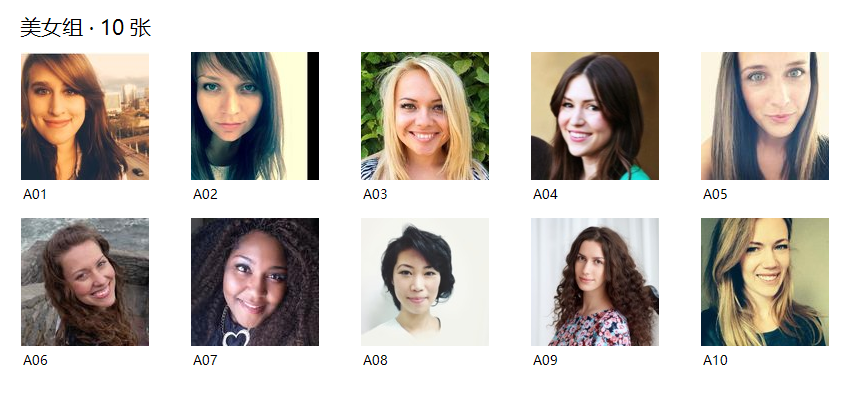
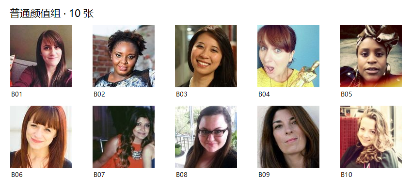
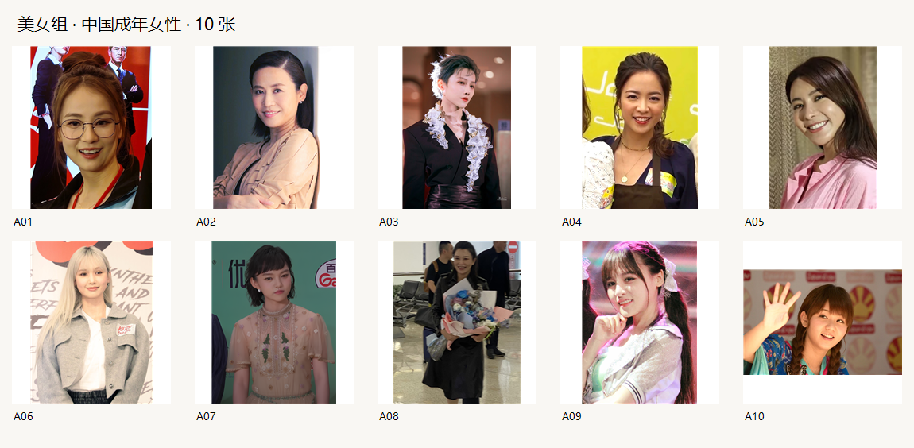
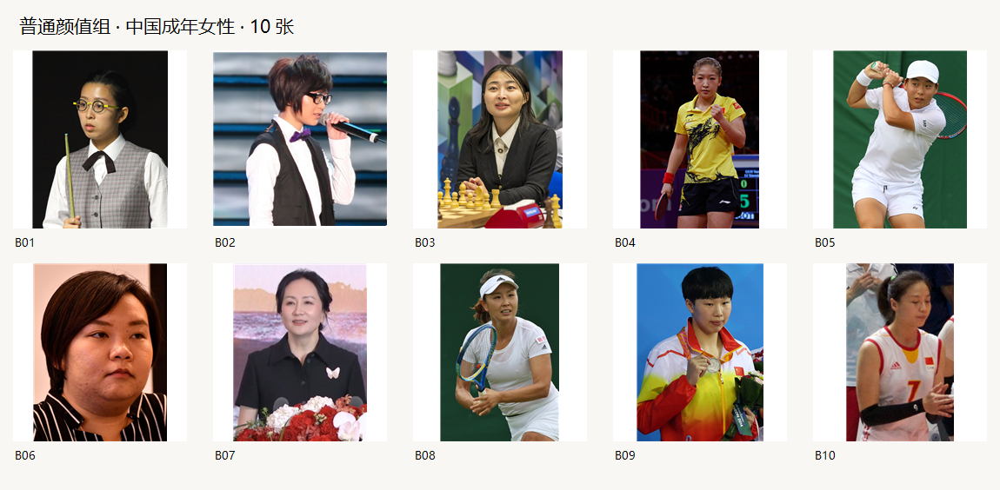

[English](README.md) | **简体中文**

# ChatGPT认为的美女是什么样？

本次进行两轮图片搜集：第一轮不限定国籍，第二轮限定中国女性。先随机获取候选，再由模型按主观观感分组，并从每组随机选取10张。

两轮共选出40张照片，其中「美女」20张、「普通颜值」20张。以下展示四组结果。

## 实验环境

- 实验日期：2026年10月6日，北京时间（Asia/Shanghai，UTC+8）。
- 模型：GPT-6.1 Sol（`gpt-6.1-sol`），推理级别 `xhigh`。
- 执行客户端：Codex 桌面端（Windows），版本 `26.930.41038`，构建 `13022`。
- ChatGPT 客户端版本：不适用；本次通过 Codex 桌面端完成，未使用独立 ChatGPT 客户端。

## 第一轮：不限定国籍

美女组（10张）：

普通颜值组（10张）：

## 第二轮：中国女性

包括大陆与香港女性。身份与成年条件依据公开人物资料和照片日期核对。

美女组（10张）：

普通颜值组（10张）：

## 图片来源与署名

第一轮：[Random User 公开头像库](https://randomuser.me/photos)及其[版权说明](https://randomuser.me/copyright)。

中国轮：图片来自 Wikimedia Commons，人物资料来自 Wikidata。摄影署名、许可证与来源如下，编号对应中国轮配图：

- 中国轮 A01：Will629，[CC0](<http://creativecommons.org/publicdomain/zero/1.0/deed.en>)。[照片来源](<https://commons.wikimedia.org/wiki/File:Vivian_Koo_20251116.jpg>) · [人物资料](<https://www.wikidata.org/wiki/Q9345825>)。
- 中国轮 A02：U Magazine HK Official，[CC BY 3.0](<https://creativecommons.org/licenses/by/3.0>)。[照片来源](<https://commons.wikimedia.org/wiki/File:Jessica_Hsuan_in_Feb_2021.jpg>) · [人物资料](<https://www.wikidata.org/wiki/Q839145>)。
- 中国轮 A03：BeforeSunrise | 刘雨昕，[CC BY-SA 4.0](<https://creativecommons.org/licenses/by-sa/4.0>)。[照片来源](<https://commons.wikimedia.org/wiki/File:XINLiu@H%C3%A4agen-DazsEvent20210112.jpg>) · [人物资料](<https://www.wikidata.org/wiki/Q95946165>)。
- 中国轮 A04：am730，[CC BY 3.0](<https://creativecommons.org/licenses/by/3.0>)。[照片来源](<https://commons.wikimedia.org/wiki/File:%E5%BD%AD%E6%85%A7%E4%B8%AD.jpg>) · [人物资料](<https://www.wikidata.org/wiki/Q18610191>)。
- 中国轮 A05：am730，[CC BY 3.0](<https://creativecommons.org/licenses/by/3.0>)。[照片来源](<https://commons.wikimedia.org/wiki/File:Shirley_Chan_%E9%99%B3%E6%AC%A3%E5%A6%8D,_%E5%8F%8D%E8%BD%89%E6%96%B9%E8%88%9F%E5%8B%95%E7%89%A9%E5%9C%98_Ooops!_2,_am730_interview_(August_2021).jpg>) · [人物资料](<https://www.wikidata.org/wiki/Q63199392>)。
- 中国轮 A06：Tombus20032000，[CC BY-SA 4.0](<https://creativecommons.org/licenses/by-sa/4.0>)。[照片来源](<https://commons.wikimedia.org/wiki/File:Nancy_Kwai_20240524.jpg>) · [人物资料](<https://www.wikidata.org/wiki/Q106272222>)。
- 中国轮 A07：China News Service 中国新闻网，[CC BY 3.0](<https://creativecommons.org/licenses/by/3.0>)。[照片来源](<https://commons.wikimedia.org/wiki/File:Lan_Xiya_(%E5%85%B0%E8%A5%BF%E9%9B%85)_on_the_White_Carpet_at_the_closing_ceremony_of_the_30th_Shanghai_TV_Festival_Magnolia_Awards_on_27_June_2025.png>) · [人物资料](<https://www.wikidata.org/wiki/Q126616301>)。
- 中国轮 A08：Bookish Worm，[CC BY 4.0](<https://creativecommons.org/licenses/by/4.0>)。[照片来源](<https://commons.wikimedia.org/wiki/File:Actress_Zhang_Yanyan_(2024)_03.jpg>) · [人物资料](<https://www.wikidata.org/wiki/Q9188465>)。
- 中国轮 A09：纸鱼_咲，[CC BY 2.5](<https://creativecommons.org/licenses/by/2.5>)。[照片来源](<https://commons.wikimedia.org/wiki/File:Zeng_Yanfen_(cropped).jpg>) · [人物资料](<https://www.wikidata.org/wiki/Q24270759>)。
- 中国轮 A10：Georges Seguin ( Okki )，[CC BY-SA 3.0](<https://creativecommons.org/licenses/by-sa/3.0>)。[照片来源](<https://commons.wikimedia.org/wiki/File:Morning_Musume_20100703_Japan_Expo_22.jpg>) · [人物资料](<https://www.wikidata.org/wiki/Q236367>)。
- 中国轮 B01：Benutzer:Bill da Flute，[CC BY-SA 3.0](<https://creativecommons.org/licenses/by-sa/3.0>)。[照片来源](<https://commons.wikimedia.org/wiki/File:Ng_On_Yee_PHC_2017-2.jpg>) · [人物资料](<https://www.wikidata.org/wiki/Q4315319>)。
- 中国轮 B02：Rearwindow  ( talk )，[CC BY 3.0](<https://creativecommons.org/licenses/by/3.0>)。[照片来源](<https://commons.wikimedia.org/wiki/File:Zhoubichang.jpg>) · [人物资料](<https://www.wikidata.org/wiki/Q3272501>)。
- 中国轮 B03：Frans Peeters，[CC BY-SA 2.0](<https://creativecommons.org/licenses/by-sa/2.0>)。[照片来源](<https://commons.wikimedia.org/wiki/File:Ju_Wenjun_in_2024_(cropped).jpg>) · [人物资料](<https://www.wikidata.org/wiki/Q468045>)。
- 中国轮 B04：Pierre-Yves Beaudouin，[CC BY-SA 4.0](<https://creativecommons.org/licenses/by-sa/4.0>)。[照片来源](<https://commons.wikimedia.org/wiki/File:Mondial_Ping_-_Women%27s_Doubles_-_Final_-_36.jpg>) · [人物资料](<https://www.wikidata.org/wiki/Q443175>)。
- 中国轮 B05：si.robi，[CC BY-SA 2.0](<https://creativecommons.org/licenses/by-sa/2.0>)。[照片来源](<https://commons.wikimedia.org/wiki/File:Bai_WMQ23_(53061717101)_(cropped).jpg>) · [人物资料](<https://www.wikidata.org/wiki/Q117385076>)。
- 中国轮 B06：Iris Tong，[Public domain](<https://commons.wikimedia.org/wiki/File:Bonnie_Leung_(cropped).jpg>)。[照片来源](<https://commons.wikimedia.org/wiki/File:Bonnie_Leung_(cropped).jpg>) · [人物资料](<https://www.wikidata.org/wiki/Q37979812>)。
- 中国轮 B07：中国新闻网，[CC BY 3.0](<https://creativecommons.org/licenses/by/3.0>)。[照片来源](<https://commons.wikimedia.org/wiki/File:%E5%AD%9F%E6%99%9A%E8%88%9F_Meng_Wanzhou_2022.jpg>) · [人物资料](<https://www.wikidata.org/wiki/Q59485866>)。
- 中国轮 B08：si.robi，[CC BY-SA 2.0](<https://creativecommons.org/licenses/by-sa/2.0>)。[照片来源](<https://commons.wikimedia.org/wiki/File:Peng_WMQ19_(28).jpg>) · [人物资料](<https://www.wikidata.org/wiki/Q229087>)。
- 中国轮 B09：Korea.net  / Korean Culture and Information Service (Jeon Han)，[CC BY-SA 2.0](<https://creativecommons.org/licenses/by-sa/2.0>)。[照片来源](<https://commons.wikimedia.org/wiki/File:Incheon_AsianGames_Swimming_27_(cropped).jpg>) · [人物资料](<https://www.wikidata.org/wiki/Q18142398>)。
- 中国轮 B10：Massimiliano Raposio，[CC BY-SA 2.0](<https://creativecommons.org/licenses/by-sa/2.0>)。[照片来源](<https://commons.wikimedia.org/wiki/File:Wei_Qiuyue.jpg>) · [人物资料](<https://www.wikidata.org/wiki/Q682725>)。
